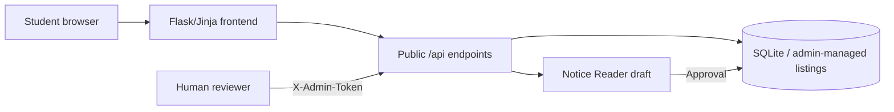

# Bursary Radar

Bursary Radar is a mobile-first, low-data funding discovery tool for Kenyan students.

> Bursary Radar is an independent student project. It is not affiliated with HELB, the Universities Fund, NG-CDF, county governments or any funder. Always confirm details at the official source. Never pay money to apply for a bursary.

## Screens

Screenshots can be placed here:

- Landing and sample profile
- Five-step profile wizard
- Matched opportunity cards
- My Plan and SMS preview
- `/poll` and `/admin`

## Architecture



The existing Flask/Jinja frontend is preserved. Public matching is stateless and student profiles are not stored. My Plan is stored only in `localStorage`.

## Run locally

```powershell
cd C:\Users\ADMIN\python_projects\BURSARY_RADAR
py -m venv .venv
.\.venv\Scripts\Activate.ps1
python -m pip install -r requirements.txt
copy .env.example .env
python app.py
```

Open `http://127.0.0.1:5000`.

## Environment

- `ADMIN_TOKEN`: enables admin routes; unset disables them
- `DATABASE_URL`: reserved for a future SQLAlchemy/PostgreSQL backend
- `CORS_ORIGINS`: comma-separated allowed browser origins
- `LLM_PROVIDER=mock`: deterministic offline Notice Reader
- `LLM_API_KEY`: provider key; not required by mock mode
- `ENABLE_SMS=false`, `AT_USERNAME`, `AT_API_KEY`, `AT_SENDER_ID`: SMS placeholders
- `APP_ENV`, `SECRET_KEY`, `HOST`, `PORT`, `FLASK_DEBUG`

## API overview

- `GET /healthz`
- `GET /api/opportunities`
- `GET /api/opportunities/{id}`
- `POST /api/match`
- `POST /api/reminders/preview`
- `POST /api/reports`
- `POST /api/feedback`
- `POST /api/events`
- `GET|POST /api/poll`
- `/api/admin/*`: protected by `X-Admin-Token`

Open `/api` is not used by Flask; no Swagger UI is enabled. Admin routes use the header-based contract.

## Tests

```powershell
python -m pytest -q
```

The tests cover confidence, public/private matching, county and constituency restrictions, reminder schedules, removed features, privacy-safe public pages and admin authentication.

## Deploy on Render

1. Push the project to a Git repository.
2. Create a Python Web Service from the repository.
3. Render will read `render.yaml`.
4. Set `ADMIN_TOKEN`, `SECRET_KEY`, `CORS_ORIGINS` and `APP_ENV=production`.
5. Use `gunicorn app:app --bind 0.0.0.0:$PORT` as the start command.

## SQLite and redeployment

Render's default disk is ephemeral. SQLite edits and verification dates may disappear on redeploy.
Export reviewed data with `GET /api/admin/export` as a backup, or configure a persistent PostgreSQL database. The application no longer seeds opportunity records on startup.

## Seed and verification

The database starts without opportunity listings. Add reviewed entries through the admin API; no sample or seed opportunities are bundled. Unknown values remain null and are presented as “Not confirmed” or “Amount not published”.

See [DATA_VERIFICATION.md](docs/DATA_VERIFICATION.md), [DEMO_SCRIPT.md](docs/DEMO_SCRIPT.md) and [ROADMAP.md](docs/ROADMAP.md).

## Limitations

- Award amounts and application windows may change.
- The database is local unless migrated to a hosted database.
- SMS delivery is a preview only; no phone number is collected.
- Mock Notice Reader output requires human review and is not an extraction engine.
- No student profile is written to disk.
