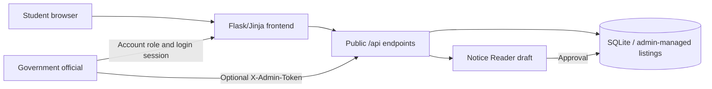

# Bursary Radar

Bursary Radar is a mobile-first, low-data funding discovery tool for Kenyan students.

> Bursary Radar is an independent student project. It is not affiliated with HELB, the Universities Fund, NG-CDF, county governments or any funder. Always confirm details at the official source. Never pay money to apply for a bursary.

## Screens

Screenshots can be placed here:

- Landing and sample profile
- Five-step profile wizard
- Matched opportunity cards
- My Plan and SMS preview
- `/poll` and `/admin`

## Architecture



The existing Flask/Jinja frontend is preserved. Public matching is stateless and profile details are not stored unless the student submits an application. My Plan is stored only in `localStorage`.

## Run locally

```powershell
cd C:\Users\ADMIN\python_projects\BURSARY_RADAR
py -m venv .venv
.\.venv\Scripts\Activate.ps1
python -m pip install -r requirements.txt
copy .env.example .env
python app.py
```

Open `http://127.0.0.1:5000`.

## Environment

- `ADMIN_TOKEN`: optional token for direct admin API clients; web admins sign in with an admin account
- `APPLICATION_DOCUMENT_KEY`: required Fernet key for encrypting retained application document images; keep it backed up and unchanged
- `TESSERACT_CMD`: optional path to the Tesseract OCR executable when it is not on `PATH`
- `INFOBIP_BASE_URL`, `INFOBIP_API_KEY`: Infobip HTTPS base host and API key; configure in ignored local `.env` or deployment secrets, never in source control
- `INFOBIP_SENDER_ID`: Infobip-approved SMS sender ID; the example value is only a placeholder
- `DATABASE_URL`: reserved for a future SQLAlchemy/PostgreSQL backend
- `CORS_ORIGINS`: comma-separated allowed browser origins
- `LLM_PROVIDER=mock`: deterministic offline Notice Reader
- `LLM_API_KEY`: provider key; not required by mock mode
- `ENABLE_SMS=false`, `AT_USERNAME`, `AT_API_KEY`, `AT_SENDER_ID`: SMS placeholders
- `APP_ENV`, `SECRET_KEY`, `HOST`, `PORT`, `FLASK_DEBUG`

## API overview

- `GET /healthz`
- `GET /api/opportunities`
- `GET /api/opportunities/{id}`
- `POST /api/match`
- `POST /api/reminders/preview`
- `POST /api/reports`
- `POST /api/feedback`
- `POST /api/events`
- `GET|POST /api/poll`
- `POST /api/applications`: submits a matched bursary application for a signed-in student
- `/api/admin/applications*`: admin-session-only application listing, document viewing, and status updates
- Infobip sends an SMS confirmation after an application is stored and alerts opted-in students when an admin publishes an open/upcoming bursary matching their saved area and study profile
- `POST /api/admin/bursaries`: creates a validated bursary using an authenticated admin session
- `/api/admin/*`: admin APIs accept an admin login session or, where supported, `X-Admin-Token`; the bursary upload endpoint requires the session

Admin accounts are selected during signup and login and require an email ending in `.go.ke`. This checks the address domain only; it does not verify control of the mailbox or government employment. The admin dashboard is at `/admin`.

Open `/api` is not used by Flask; no Swagger UI is enabled. Admin routes use the header-based contract.

## Tests

```powershell
python -m pytest -q
```

The tests cover confidence, public/private matching, county and constituency restrictions, reminder schedules, removed features, role-based admin access, bursary validation and admin authentication.

### Student applications and document processing

Students can apply from personalized results. The application confirms the current county and constituency from the matching profile and checks those values against the bursary's county/constituency restrictions. This is a self-declared location match, not proof of residence. Kenyan ID and birth-certificate images are OCR-screened and retained encrypted in SQLite for admin review; an optional passport image is OCR-scanned for ICAO TD3 MRZ checks. OCR/MRZ results are advisory and require human review. ID cards and birth certificates generally do not have an MRZ, and an MRZ cannot establish current residence.

Student signup requires a valid Kenyan mobile number and SMS consent. The number is normalized to E.164. When an opted-in student searches, their county, constituency, study level and relevant institution details are saved to target matching bursary alerts; optional need indicators are not stored. SMS is outbound only; inbound replies are not configured. If Infobip is unavailable, the application remains saved and the UI clearly reports that its confirmation SMS was not accepted. The admin bursary upload is also preserved if an alert send fails.

Set `INFOBIP_BASE_URL` to the HTTPS Infobip API host, `INFOBIP_API_KEY` to a secret, and `INFOBIP_SENDER_ID` to a sender approved for your account/route. The example sender is a placeholder and may not be accepted by Infobip. Provider acceptance is not a guarantee of handset delivery. Never commit `.env`; rotate any API key pasted into chats or otherwise exposed before production use.

Install Tesseract OCR on local hosts (and put its executable on `PATH`, or set `TESSERACT_CMD`). Render installs the Tesseract system package during build. Generate an application-document key with:

```powershell
python -c "from cryptography.fernet import Fernet; print(Fernet.generate_key().decode())"
```

Set that value as `APPLICATION_DOCUMENT_KEY` in `.env` and in the deployment environment. Back it up securely: losing or changing the key makes retained application images unreadable. Only authenticated admin sessions can list applications or view the retained documents.

## Deploy on Render

1. Push the project to a Git repository.
2. Create a Python Web Service from the repository.
3. Render will read `render.yaml`.
4. Set `SECRET_KEY`, `APPLICATION_DOCUMENT_KEY`, `CORS_ORIGINS` and `APP_ENV=production`. Set `ADMIN_TOKEN` only if direct API-token access is required.
5. Use `gunicorn app:app --bind 0.0.0.0:$PORT` as the start command.

## SQLite and redeployment

Render's default disk is ephemeral. SQLite edits, applications, retained documents and verification dates may disappear on redeploy.
Export reviewed data with `GET /api/admin/export` as a backup, or configure a persistent PostgreSQL database. The application no longer seeds opportunity records on startup.

## Seed and verification

The database starts without opportunity listings. Government officials can sign in at `/admin` and submit bursaries with their official source, eligibility, number of awards, application window, disbursement dates and application details. No sample or seed opportunities are bundled.

See [DATA_VERIFICATION.md](docs/DATA_VERIFICATION.md), [DEMO_SCRIPT.md](docs/DEMO_SCRIPT.md) and [ROADMAP.md](docs/ROADMAP.md).

## Limitations

- Award amounts and application windows may change.
- The database is local unless migrated to a hosted database.
- SMS reminder scheduling is preview-only. Application confirmations and new matching bursary alerts use Infobip when configured.
- Mock Notice Reader output requires human review and is not an extraction engine.
- Student matching profiles are not stored unless submitted with an application.
thank you
